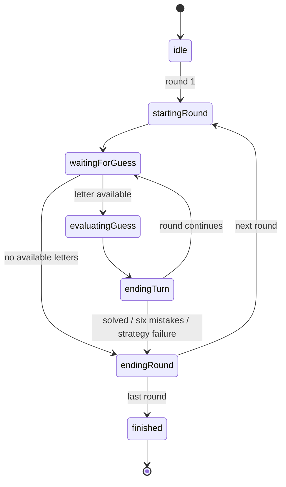

# Competitive Hangman — лабораторная работа на Swift

Консольная соревновательная «Виселица» в формате macOS Swift Playground. Игра проходит автоматически, без чтения ввода с клавиатуры и без UI-фреймворков. Она рассчитана на запуск в Xcode на Mac.

## Цель лабораторной

Реализовать механику настольной игры с конечным автоматом, несколькими объектами с поведением, автоматическими игроками, протоколами, Observer и Delegate. Движок ведёт пять раундов по умолчанию, публикует события и определяет победителя по сумме очков.

## Правила игры

- Участвуют от двух до четырёх игроков; демонстрационная партия использует Alice и Bob.
- Перед каждым раундом из встроенного словаря выбирается английское слово в верхнем регистре. В начале раунда игроки видят только скрытый шаблон.
- Игроки по очереди выбирают ещё не использованную букву. Правильная буква открывает все совпадения и приносит 10 очков за каждое. Открывший последнюю букву получает ещё 20 очков.
- Неправильная буква отнимает у назвавшего её игрока 5 очков и добавляет одну ошибку раунда. Отрицательные результаты разрешены.
- Шесть ошибок завершают раунд поражением. Успешное раскрытие слова также завершает раунд.
- Стартующий игрок сдвигается на одного участника в каждом следующем раунде.
- После пяти раундов выигрывает игрок с наибольшим счётом. При равенстве объявляется ничья между лидерами.

Alice использует стратегию частотности английских букв, Bob — случайную стратегию. Для случайных решений применяется seed `20261115`, поэтому демонстрационная сессия воспроизводима.

## Игровые объекты и архитектура

| Компонент | Ответственность |
| --- | --- |
| `Game` | Переходы FSM, раунды, ходы, очки, события и определение победителя. Не печатает в консоль. |
| `Player` | Идентификатор, имя, счёт и стратегия выбора буквы. |
| `WordPuzzle` | Скрытое слово, использованные буквы, шаблон и раскрытие совпадений. Секрет не входит в интерфейс стратегии. |
| `HangmanDrawing` | Ошибки, ограничение попыток и ASCII-рисунок соответствующей стадии. |
| `WordDictionary` | Отдельный проверяемый словарь технологий и выбор слова генератором. |
| `GameRule` | Правила завершения раунда: раскрытое слово и лимит ошибок. |
| `ConsoleGameObserver` | Преобразует события игры в подробный консольный журнал. |
| `StatisticsObserver` | Считает ходы, правильные и неправильные попытки, завершённые раунды и разгаданные слова. |
| `GameLifecycleDelegate` | Записывает вызовы жизненного цикла: начало/завершение раундов и завершение всей игры. |

### Протоколы

- `PlayerStrategy` задаёт поведение выбора буквы. Его реализуют `RandomLetterStrategy` и `FrequencyLetterStrategy`; движок вызывает их полиморфно через протокол.
- `WordGuessing` задаёт операции над загадкой, не открывая слово стратегии. `WordPuzzle` реализует этот интерфейс и передаётся правилам раунда как `WordGuessing`.
- `GameRule` проверяет условия окончания раунда. В `Game` хранится массив протокольных правил, поэтому правила можно расширять без изменения цикла ходов.
- `GameObserver` получает широковещательные `GameEvent`. Движок хранит слабые ссылки, а `addObserver`/`removeObserver` позволяют управлять подписками.
- `GameDelegate` принимает отдельные уведомления о важных событиях жизненного цикла. Ссылка движка на делегат слабая. `GameLifecycleDelegate` сохраняет историю уведомлений для проверок.

## Конечный автомат

Состояние игры хранится одним значением `GameState`. Переходы проверяются методом `allowsTransition(to:)`; `Game.transition(to:)` выбрасывает `GameError.invalidTransition`, если ребро запрещено.



| Текущее состояние | Следующее состояние | Условие |
| --- | --- | --- |
| `idle` | `startingRound(1)` | Запущена новая игра |
| `startingRound(n)` | `waitingForGuess(n, player)` | Слово и состояние раунда готовы |
| `waitingForGuess(n, player)` | `evaluatingGuess(n, player, letter)` | Стратегия выбрала букву |
| `waitingForGuess(n, player)` | `endingRound(n, noAvailableLetters)` | Стратегия исчерпала все допустимые буквы |
| `evaluatingGuess(n, player, letter)` | `endingTurn(n, nextPlayer)` | Попытка оценена и очки применены |
| `endingTurn(n, nextPlayer)` | `waitingForGuess(n, nextPlayer)` | Условия завершения раунда не выполнены |
| `endingTurn(n, nextPlayer)` | `endingRound(n, result)` | Слово разгадано, достигнут лимит ошибок или стратегия нарушила контракт |
| `endingRound(n, result)` | `startingRound(n + 1)` | Остались раунды |
| `endingRound(n, result)` | `finished` | Последний раунд завершён |

## Observer и Delegate

После изменения игрового состояния движок публикует `GameEvent`. `ConsoleGameObserver` отвечает за текст, `StatisticsObserver` — за агрегаты. Подписчики не влияют на FSM. Событие с решением раунда содержит слово только после завершения раунда.

Делегат получает три отдельные группы callback: новый раунд, завершённый раунд и окончание игры. Это узкий канал жизненного цикла; он не заменяет широковещательную рассылку игровых событий.

## Пример журнала

Фактическое слово и ходы зависят от seed и словаря. Секрет не появляется в журнале до завершения раунда.

```text
Started a new game of Competitive Hangman
Players: Alice, Bob
Rounds: 5
======

ROUND 1
Secret word: _ _ _ _ _ (5 letters)
Starting player: Alice
Mistakes: 0/6

Alice's turn
Alice guesses: E
Correct guess! Revealed 1 occurrence(s).
Current word: _ E _ _ _
Alice earns 10 points (score: 10)

Bob's turn
Bob guesses: Z
Wrong guess!
Current word: _ E _ _ _
Mistakes: 1/6
 +---+
 |   |
     |
 O   |
     |
     |
=======
Bob loses 5 points (score: -5)
```

Журнал также показывает завершение каждого раунда, итоговую таблицу, победителя/ничью и сводку статистики наблюдателя.

## Запуск в Xcode

1. Перенесите репозиторий на Mac (инструкции ниже) и откройте файл `CompetitiveHangman.playground` через Xcode: **File → Open**.
2. Убедитесь, что Playground использует платформу macOS. Никакой iOS target или UI-фреймворк не нужен.
3. Запустите страницу `Contents.swift` кнопкой воспроизведения. Сначала выполняются встроенные проверки бизнес-логики, затем выводится демонстрационная партия в консоль Xcode.
4. Если консоль скрыта, откройте область отладки Xcode (**View → Debug Area → Activate Console**).

## Журнал ошибок

Перехваченные ошибки игры и проваленные встроенные проверки дописываются в `CompetitiveHangman.playground/runtime-errors.log`. В консоли Xcode печатается путь к файлу. Журнал создаётся только после первой ошибки; ошибки компиляции в него попасть не могут, так как Playground в этом случае не запускается.

Чтобы забрать журнал через Git, после ошибки на Mac добавьте и отправьте его в удалённый репозиторий:

```bash
git add CompetitiveHangman.playground/runtime-errors.log
git commit -m "Add Xcode runtime error log"
git push
```

На другом компьютере получите коммит командой `git pull`.

## Перенос через GitHub

В каталоге `CompetitiveHangman` создайте репозиторий и отправьте его в свой удалённый GitHub-репозиторий обычным Git-клиентом или терминалом:

```bash
git init
git add .
git commit -m "Add Competitive Hangman Swift Playground"
git branch -M main
git remote add origin <URL-вашего-репозитория>
git push -u origin main
```

На университетском Mac клонируйте репозиторий и откройте `CompetitiveHangman/CompetitiveHangman.playground` в Xcode. Этот проект не содержит бинарных зависимостей.

## Встроенные проверки

`Contents.swift` запускает проверки без XCTest и внешних зависимостей:

1. Словарь нормализует регистр, проверяет данные и содержит не менее 20 слов.
2. Правильная буква раскрывает все вхождения; повторная буква отклоняется.
3. Неправильные буквы увеличивают ошибки, обновляют рисунок и вычитают 5 очков.
4. Порядок игроков корректен, очки за совпадения и бонус раскрытия слова начисляются правильно.
5. Успех и поражение после шести ошибок завершают раунд.
6. Ошибки ограничены шестью; отрицательные очки разрешены.
7. Пять раундов завершают FSM, стартовый игрок меняется, победитель определяется по общему счёту.
8. Равный максимальный счёт приводит к ничьей.
9. FSM отклоняет запрещённые переходы.
10. Observer считает события, подписка снимается, Delegate получает события раундов и игры.
11. Контекст стратегии содержит публичный шаблон и использованные буквы без поля с секретным словом.

## Проверка требований преподавателя

| Требование | Реализация |
| --- | --- |
| 3+ игровых объекта с поведением | `Game`, `Player`, `WordPuzzle`, `HangmanDrawing`, `WordDictionary` |
| 2+ игрока и смена ходов | `Game.players`, индекс активного игрока и `endingTurn` |
| Явный FSM | `GameState` и проверяемый `Game.transition(to:)` |
| Основные действия и условие завершения | `WordPuzzle.submit`, стратегии, `GameRule`, лимит ошибок и счёт |
| Автоматическая игра от начала до конца | Точка запуска в `Contents.swift`, без ручного ввода |
| Observer, статистика и отписка | `GameObserver`, `ConsoleGameObserver`, `StatisticsObserver`, `addObserver`/`removeObserver` |
| Delegate жизненного цикла | `GameDelegate`, `GameLifecycleDelegate`, слабая ссылка в `Game` |
| Протоколы поведения | `PlayerStrategy`, `WordGuessing`, `GameRule`, `GameObserver`, `GameDelegate` |
| Повторяемый генератор | `SeededRandomGenerator` и параметр `seed` у `Game` |

## Ограничения

- Playground предназначен для Xcode на macOS. На Windows в этом проекте нет Xcode, поэтому файл создан для открытия на университетском Mac.
- Игроки используют простые стратегии, как допускает задание; сложного анализа слова нет.
- Слова выбираются случайно с возможными повторами между раундами.
- Проверки находятся в `Contents.swift` и выполняются при запуске Playground, отдельного XCTest target нет.
